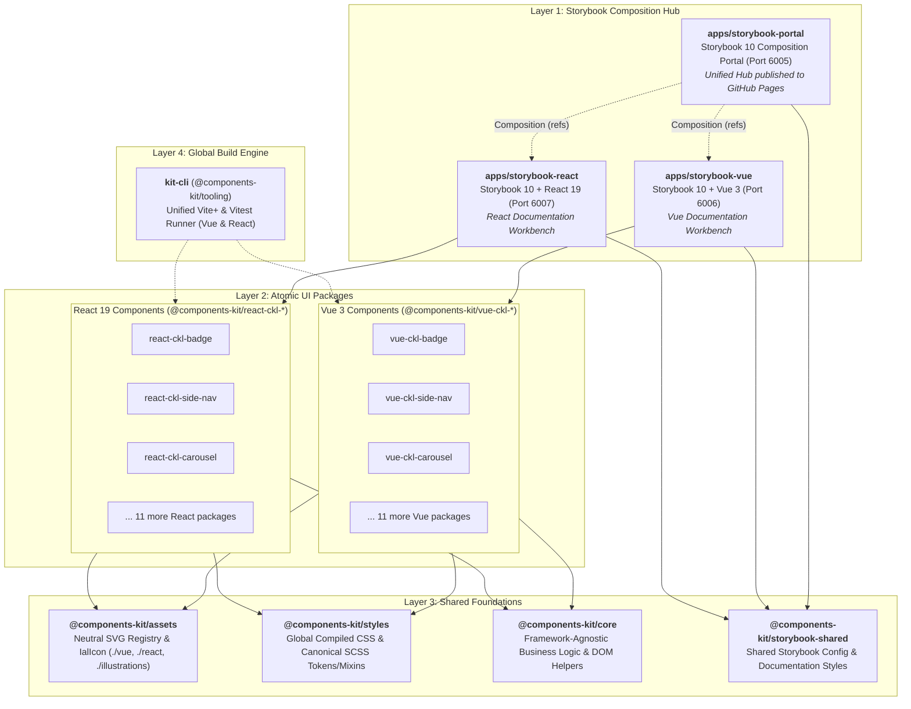

<div align="center">

# Components Kit

### Dual-Framework UI Component Library (Vue 3 & React 19)

A high-performance, modular monorepo engineered with **Vue 3**, **React 19**, **Vite+ (Rolldown)**, **Storybook 10**, **pnpm 11**, **Lerna 10**, and **Nx 23**.

[](https://vuejs.org/)
[](https://react.dev/)
[](https://viteplus.dev/)
[](https://storybook.js.org/)
[](https://nelomr.github.io/components-kit/)
[](https://github.com/nelomr/components-kit/actions/workflows/deploy-storybook.yml)
[](https://vitest.dev/)
[](https://pnpm.io/)
[](https://lerna.js.org/)
[](https://nx.dev/)
[](https://nodejs.org/)
[](./LICENSE)

<br/>

[**🌐 Live Storybook**](https://nelomr.github.io/components-kit/) •
[**Explore Components**](#component-catalog) •
[**Quick Start**](#quick-start) •
[**Storybook (Vue & React)**](#storybook-composition-hub) •
[**Architecture**](#architecture) •
[**Vite+ Guide**](./docs/VITE_PLUS_GUIDE.md) •
[**Monorepo Guide**](./docs/MONOREPO_GUIDE.md) •
[**Theming**](#theming--customization) •
[**Contributing**](#contributing--standards)

---

</div>

> [!TIP]
> **Homogeneous Dual-Framework Monorepo**: All 14 UI components are implemented in both **Vue 3** (`packages/vue/`) and **React 19** (`packages/react/`). They share single-source SCSS stylesheets, pure mathematical helpers, SVG icon registries, and dedicated Storybook 10 development workbenches.

## Key Highlights

<table>
  <tr>
    <td width="33%" valign="top">
      <h4>Instant DX & HMR</h4>
      <p>Powered by <b>Vite+ (Rolldown)</b> and <b>Storybook 10</b> with sub-second cold starts (~300ms) and instant hot module replacement across Vue and React.</p>
    </td>
    <td width="33%" valign="top">
      <h4>Dual Atomic Workspaces</h4>
      <p>14 Vue packages (<code>@components-kit/vue-ckl-*</code>) and 14 React packages (<code>@components-kit/react-ckl-*</code>) with independent versioning and tree-shaking.</p>
    </td>
    <td width="33%" valign="top">
      <h4>Single-Source SCSS</h4>
      <p>Zero styling duplication. React components import the canonical SCSS token definitions, retaining identical visual fidelity, CSS variables (<code>--ckl-*</code>), and mixins.</p>
    </td>
  </tr>
  <tr>
    <td width="33%" valign="top">
      <h4>WCAG 2.1 AA Accessible</h4>
      <p>Built with semantic HTML, full ARIA roles, live regions, and keyboard-first navigation patterns across both frameworks.</p>
    </td>
    <td width="33%" valign="top">
      <h4>High-Performance React</h4>
      <p>Engineered with <code>React.memo</code>, memoized callbacks/computations, and decoupled listener cleanups to prevent re-render cascades.</p>
    </td>
    <td width="33%" valign="top">
      <h4>Curated Icon System</h4>
      <p>Tree-shakeable SVG icon factory and async/dynamic component resolvers for both Vue (<code>IalIcon</code>) and React (<code>IalIcon</code>).</p>
    </td>
  </tr>
</table>

---

## Component Catalog

Each component is available as an independent package for both Vue 3 and React 19:

| Component           | Vue 3 Package                                                                   | React 19 Package                                                                    | Description                                                                   |  Status  |
| :------------------ | :------------------------------------------------------------------------------ | :---------------------------------------------------------------------------------- | :---------------------------------------------------------------------------- | :------: |
| **Badge**           | [`@components-kit/vue-ckl-badge`](./packages/vue/ckl-badge)                     | [`@components-kit/react-ckl-badge`](./packages/react/ckl-badge)                     | Status badges, notification pills, count tags, and outline variants           | `Stable` |
| **Barometer Chart** | [`@components-kit/vue-ckl-barometer-chart`](./packages/vue/ckl-barometer-chart) | [`@components-kit/react-ckl-barometer-chart`](./packages/react/ckl-barometer-chart) | Animated SVG speedometer and gauge chart with dynamic needle rotation         | `Stable` |
| **Breadcrumb**      | [`@components-kit/vue-ckl-breadcrumb`](./packages/vue/ckl-breadcrumb)           | [`@components-kit/react-ckl-breadcrumb`](./packages/react/ckl-breadcrumb)           | Hierarchical navigation trail with custom routing and route triggers          | `Stable` |
| **Carousel**        | [`@components-kit/vue-ckl-carousel`](./packages/vue/ckl-carousel)               | [`@components-kit/react-ckl-carousel`](./packages/react/ckl-carousel)               | Multi-item track carousel with touch, swipe, keyboard, and imperative handles | `Stable` |
| **Horizontal Tabs** | [`@components-kit/vue-ckl-horizontal-tabs`](./packages/vue/ckl-horizontal-tabs) | [`@components-kit/react-ckl-horizontal-tabs`](./packages/react/ckl-horizontal-tabs) | Tab bar navigation with icon slots, badge counters, and keyboard cycling      | `Stable` |
| **Icon**            | [`@components-kit/vue-ckl-icon`](./packages/vue/ckl-icon)                       | [`@components-kit/react-ckl-icon`](./packages/react/ckl-icon)                       | Base icon container supporting custom SVGs, sizes, colors, and states         | `Stable` |
| **Loader**          | [`@components-kit/vue-ckl-loader`](./packages/vue/ckl-loader)                   | [`@components-kit/react-ckl-loader`](./packages/react/ckl-loader)                   | Lightweight, themeable SVG activity indicator and circular spinner            | `Stable` |
| **Pagination**      | [`@components-kit/vue-ckl-pagination`](./packages/vue/ckl-pagination)           | [`@components-kit/react-ckl-pagination`](./packages/react/ckl-pagination)           | Navigation bar with direct page jumping, ellipses, and step controls          | `Stable` |
| **Progress Bar**    | [`@components-kit/vue-ckl-progress-bar`](./packages/vue/ckl-progress-bar)       | [`@components-kit/react-ckl-progress-bar`](./packages/react/ckl-progress-bar)       | Linear progress indicators with percentage labels and state animations        | `Stable` |
| **Side Nav**        | [`@components-kit/vue-ckl-side-nav`](./packages/vue/ckl-side-nav)               | [`@components-kit/react-ckl-side-nav`](./packages/react/ckl-side-nav)               | Multi-level collapsible side navigation with nested items and badges          | `Stable` |
| **Slides**          | [`@components-kit/vue-ckl-slides`](./packages/vue/ckl-slides)                   | [`@components-kit/react-ckl-slides`](./packages/react/ckl-slides)                   | Viewport slider component with bound checks and slide transitions             | `Stable` |
| **Tooltip**         | [`@components-kit/vue-ckl-tooltip`](./packages/vue/ckl-tooltip)                 | [`@components-kit/react-ckl-tooltip`](./packages/react/ckl-tooltip)                 | Floating tooltip with dynamic viewport positioning, Portal, and outside-click | `Stable` |
| **Truncate Text**   | [`@components-kit/vue-ckl-truncate-text`](./packages/vue/ckl-truncate-text)     | [`@components-kit/react-ckl-truncate-text`](./packages/react/ckl-truncate-text)     | Line-clamped text container with ellipsis and item counter overflow           | `Stable` |
| **Vertical Tabs**   | [`@components-kit/vue-ckl-vertical-tabs`](./packages/vue/ckl-vertical-tabs)     | [`@components-kit/react-ckl-vertical-tabs`](./packages/react/ckl-vertical-tabs)     | Vertical stacked tab list with dual icon support and disabled states          | `Stable` |
| **Assets & Icons**  | [`@components-kit/assets`](./packages/assets)                                   | [`@components-kit/assets/react`](./packages/assets)                                 | Curated SVG icon registry, `IalIcon` resolver, and dynamic icon factory       | `Stable` |
| **Helpers Core**    | [`@components-kit/core`](./packages/core)                                       | [`@components-kit/core`](./packages/core)                                           | Framework-agnostic DOM events, outside-click handlers, and pagination math    | `Stable` |

---

<a id="architecture"></a>

## Architecture

Components Kit is architected as a **symmetric dual-framework monorepo** using **pnpm Workspaces**, **Lerna 10**, **Nx 23**, and **Vite+** (powered by Rolldown).

### System Architecture Diagram



---

### Directory Map

```text
components-kit/
├── apps/
│   ├── storybook-portal/              # Storybook 10 Composition Portal & GitHub Pages Hub (Port 6005)
│   ├── storybook-vue/                 # Storybook 10 visual workbench for Vue 3 (Port 6006)
│   └── storybook-react/               # Storybook 10 visual workbench for React 19 (Port 6007)
├── packages/
│   ├── assets/                        # Framework-neutral SVG registry (./vue, ./react, ./illustrations/*)
│   ├── core/                          # Framework-agnostic pure logic, math, and DOM helpers
│   ├── styles/                        # Global component CSS bundle (dist/ckl.css), per-component CSS, SCSS mixins
│   ├── storybook-shared/              # Shared Storybook documentation styles, themes, and configuration factory
│   ├── tooling/                       # Unified build & test runner for Vue & React (kit-cli)
│   ├── vue/                           # 14 Atomic Vue 3 UI components (@components-kit/vue-ckl-*)
│   │   ├── ckl-badge/                 # Status badges & count pills (Vue 3)
│   │   ├── ckl-side-nav/              # Multi-level side navigation (Vue 3)
│   │   └── ...                        # 12 additional Vue packages
│   └── react/                         # 14 Atomic React 19 UI components (@components-kit/react-ckl-*)
│       ├── ckl-badge/                 # Status badges & count pills (React 19)
│       ├── ckl-side-nav/              # Multi-level side navigation (React 19)
│       └── ...                        # 12 additional React packages
├── scripts/
│   └── check-workspace.mjs            # Architecture validator enforcing naming, boundary, and styling rules
```

---

## Quick Start

### 1. Prerequisites

- **Node.js**: `>= 24.0.0`
- **pnpm**: `v11.x` (or `v10.x`)

### 2. Installation

```bash
git clone https://github.com/your-org/components-kit.git
cd components-kit
pnpm install
```

### 3. Launch Storybook

Launch the unified Composition Portal (which aggregates both Vue and React workbenches simultaneously) or run an individual workbench:

```bash
# Launch ALL Storybooks in parallel (Portal at 6005, Vue at 6006, React at 6007)
pnpm storybook:dev

# Or launch independently:
pnpm storybook:portal:dev    # Unified Composition Portal (Port 6005)
pnpm storybook:vue:dev       # Vue 3 Storybook (Port 6006)
pnpm storybook:react:dev     # React 19 Storybook (Port 6007)
```

---

## Storybook Composition Hub

Components Kit features a **3-tier Storybook Composition architecture** allowing Vue 3 and React 19 libraries to be developed independently while presenting a seamless, unified documentation portal:

- **Unified Composition Portal (`apps/storybook` - Port 6005)**:
  Connects to `vue-components` and `react-components` using Storybook Composition `refs`. In development, it live-queries ports `6006` and `6007`. In production, it aggregates static builds into a single bundle published to GitHub Pages.
- **Vue 3 Workbench (`apps/storybook-vue` - Port 6006)**:
  Dedicated environment for Vue 3 components with Vite+ and `@storybook/vue3-vite`.
- **React 19 Workbench (`apps/storybook-react` - Port 6007)**:
  Dedicated environment for React 19 components with Vite+ and `@storybook/react-vite`.

```bash
# Development
pnpm storybook:dev           # Run Portal + Vue + React simultaneously in parallel
pnpm storybook:portal:dev    # Run Portal only (http://localhost:6005)
pnpm storybook:vue:dev       # Run Vue 3 only (http://localhost:6006)
pnpm storybook:react:dev     # Run React 19 only (http://localhost:6007)

# Production Build & GitHub Pages
pnpm storybook:build         # Compiles Vue, React, and nests into Portal for static composition
pnpm build-storybook         # Alias for storybook:build (used in GitHub Actions CI/CD)
```

---

## Workspace Scripts

All workspace operations are accessible via unified root commands:

| Command                     | Action                 | Description                                                           |
| :-------------------------- | :--------------------- | :-------------------------------------------------------------------- |
| `pnpm storybook:dev`        | **All Storybooks**     | Launches Portal (6005), Vue (6006), and React (6007) in parallel      |
| `pnpm storybook:portal:dev` | **Composition Portal** | Launches the unified Storybook composition host on port 6005          |
| `pnpm storybook:vue:dev`    | **Vue Storybook**      | Launches Vue 3 Storybook on port 6006                                 |
| `pnpm storybook:react:dev`  | **React Storybook**    | Launches React 19 Storybook on port 6007                              |
| `pnpm storybook:build`      | **Storybook Build**    | Compiles Vue & React, bundles static Composition Hub for GitHub Pages |
| `pnpm test`                 | **Unit Tests**         | Runs Vitest 5 across all 28 component test suites in parallel         |
| `pnpm build`                | **Production Build**   | Builds all Vue and React component libraries into ESM via Rolldown    |
| `pnpm lint`                 | **Code Quality**       | Runs Oxlint scan across the entire workspace in < 700ms               |
| `pnpm fmt`                  | **Code Formatting**    | Formats files using Oxfmt (`vp fmt`)                                  |
| `pnpm check`                | **Unified Gate**       | Runs linting, formatting, and type checks in a single pass            |

---

## Usage Examples

### 1. Global CSS Import (Required for Consumers)

Components in `components-kit` ship without inline `<style>` tags or runtime CSS injections to allow full control over bundle size and tree-shaking. Consumer applications must import the stylesheet:

```javascript
// In your application root entry point (e.g. main.js / main.ts / App.jsx)

// Option A: Import the full component CSS bundle once (Recommended)
import "@components-kit/styles/css";

// Option B: Import per-component CSS stylesheets (for granular tree-shaking)
import "@components-kit/styles/css/ckl-badge.css";
```

### 2. Using in Vue 3

```vue
<script setup>
import { ref } from "vue";
import { CklBadge } from "@components-kit/vue-ckl-badge";
import { IalIcon } from "@components-kit/assets/vue";

const count = ref(5);
</script>

<template>
  <div class="user-profile">
    <ial-icon icon="ial-user" size="large" color="primary" />
    <ckl-badge color="primary" shape="oval">
      {{ count }}
    </ckl-badge>
  </div>
</template>
```

### 3. Using in React 19

```jsx
import React, { useState } from "react";
import { CklBadge } from "@components-kit/react-ckl-badge";
import { IalIcon } from "@components-kit/assets/react";

export function UserProfile() {
  const [count, setCount] = useState(5);

  return (
    <div className="user-profile">
      <IalIcon icon="ial-user" size="large" color="primary" />
      <CklBadge color="primary" shape="oval">
        {count}
      </CklBadge>
    </div>
  );
}
```

---

<a id="theming--customization"></a>

## Theming & Customization

Components Kit uses single-source CSS Custom Properties for theming across both frameworks:

```css
/* Example: Customizing CklBadge appearance (applies to both Vue & React) */
.custom-theme {
  --ckl-badge-background-color: var(--primary);
  --ckl-badge-border-color: var(--primary);
  --ckl-badge-title-color: #ffffff;
  --ckl-badge-border-radius: 28px;
  --ckl-badge-padding: 8px 12px;
}

/* Example: Theming CklSideNav */
.dark-theme {
  --ckl-side-nav-background-color: #222222;
  --ckl-side-nav-item-color: #ffffff;
  --ckl-side-nav-item-background-color-active: #333333;
}
```

---

## Testing & Quality Assurance

Unit and integration tests run across all 28 packages:

```bash
# Run all test suites in parallel (Vue + React)
pnpm test

# Test a specific React package
pnpm --filter @components-kit/react-ckl-carousel test

# Test a specific Vue package
pnpm --filter @components-kit/vue-ckl-carousel test
```

---

## Contributing & Standards

We enforce strict quality standards across all contributions:

- **Zero Cross-Component Coupling**: Primitives are composed via shared packages or slots/children.
- **Symmetric Parity**: Features and styling bugfixes must be maintained in both Vue 3 and React 19 packages.
- **Code Style**: Run `pnpm lint` and `pnpm check` before opening a pull request.

---

## License

This project is licensed under the [MIT License](./LICENSE).
