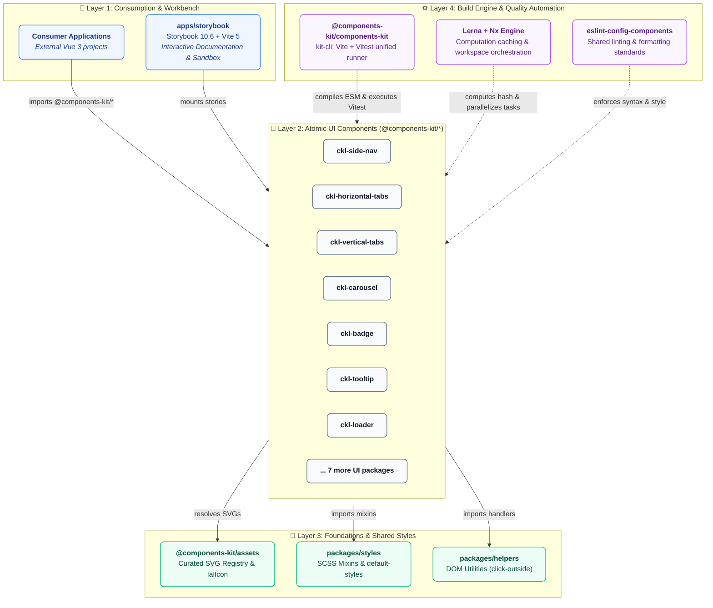

<div align="center">

# ❖ COMPONENTS KIT

### Vue 3 UI Component Library

A high-performance, modular monorepo engineered with **Vue 3**, **Vite 5**, **Storybook 10**, **Lerna 10**, and **Nx 23**.

[](https://vuejs.org/)
[](https://vite.dev/)
[](https://storybook.js.org/)
[](https://vitest.dev/)
[](https://lerna.js.org/)
[](https://nx.dev/)
[](https://nodejs.org/)
[](./LICENSE)

<br/>

[**Explore Components**](#-component-catalog) •
[**Quick Start**](#-quick-start) •
[**Storybook 10**](#-storybook-workbench) •
[**Architecture**](#-architecture) •
[**Lerna 10 Guide**](./docs/MONOREPO_GUIDE.md) •
[**Component Theming**](#-theming--customization) •
[**Contributing**](#-contributing--standards)

---

</div>

> [!TIP]
> 📖 **New to the monorepo?** Check out the **[Definitive Lerna 10 & Nx Workspaces Guide](./docs/MONOREPO_GUIDE.md)** with step-by-step tutorials on creating components, running scoped package tasks, dependency management, and leveraging computation caching.

## ✦ Key Highlights

<table>
  <tr>
    <td width="33%" valign="top">
      <h4>⚡ Instant DX & HMR</h4>
      <p>Powered by <b>Vite 5</b> and <b>Storybook 10</b> with sub-second cold starts (~400ms) and instant hot module replacement.</p>
    </td>
    <td width="33%" valign="top">
      <h4>🧩 Atomic Workspaces</h4>
      <p>14 standalone component packages (<code>@components-kit/ckl-*</code>) built for extreme modularity and independent versioning.</p>
    </td>
    <td width="33%" valign="top">
      <h4>🎨 CSS Variable Theming</h4>
      <p>Customizable via CSS custom properties (<code>--ckl-*</code>) and SCSS mixins for container-scoped or global overrides.</p>
    </td>
  </tr>
  <tr>
    <td width="33%" valign="top">
      <h4>♿ WCAG 2.1 Accessible</h4>
      <p>Built with accessible HTML semantics, full ARIA 1.2 roledescription attributes, and keyboard-first navigation.</p>
    </td>
    <td width="33%" valign="top">
      <h4>🧪 100% Tested & Cached</h4>
      <p>Multi-project Vitest test suites executing across all packages in parallel with Nx computation caching.</p>
    </td>
    <td width="33%" valign="top">
      <h4>📦 Curated Icon System</h4>
      <p>Dynamic, tree-shakeable SVG icon factory and async component resolver with zero unused asset bloat.</p>
    </td>
  </tr>
</table>

---

## 📦 Component Catalog

Each component lives as an independent workspace in [`packages/components/`](./packages/components) and can be consumed standalone or as part of the unified kit:

| Component           | Package                                                                            | Description                                                                    |  Status  |                             Documentation                              |
| :------------------ | :--------------------------------------------------------------------------------- | :----------------------------------------------------------------------------- | :------: | :--------------------------------------------------------------------: |
| **Badge**           | [`@components-kit/ckl-badge`](./packages/components/ckl-badge)                     | Status badges, notification pills, count tags, and outline variants            | `Stable` |      [📖 Readme & API](./packages/components/ckl-badge/README.md)      |
| **Barometer Chart** | [`@components-kit/ckl-barometer-chart`](./packages/components/ckl-barometer-chart) | Animated SVG speedometer and gauge chart with dynamic needle rotation          | `Stable` | [📖 Readme & API](./packages/components/ckl-barometer-chart/README.md) |
| **Breadcrumb**      | [`@components-kit/ckl-breadcrumb`](./packages/components/ckl-breadcrumb)           | Hierarchical navigation trail with custom routing and route triggers           | `Stable` |   [📖 Readme & API](./packages/components/ckl-breadcrumb/README.md)    |
| **Carousel**        | [`@components-kit/ckl-carousel`](./packages/components/ckl-carousel)               | Multi-item track carousel with touch, swipe, keyboard, and slot support        | `Stable` |    [📖 Readme & API](./packages/components/ckl-carousel/README.md)     |
| **Horizontal Tabs** | [`@components-kit/ckl-horizontal-tabs`](./packages/components/ckl-horizontal-tabs) | Tab bar navigation with icon slots, badge counters, and keyboard cycling       | `Stable` | [📖 Readme & API](./packages/components/ckl-horizontal-tabs/README.md) |
| **Icon**            | [`@components-kit/ckl-icon`](./packages/components/ckl-icon)                       | Base icon container supporting custom SVGs, sizes, colors, and states          | `Stable` |      [📖 Readme & API](./packages/components/ckl-icon/README.md)       |
| **Loader**          | [`@components-kit/ckl-loader`](./packages/components/ckl-loader)                   | Lightweight, themeable SVG activity indicator and circular spinner             | `Stable` |     [📖 Readme & API](./packages/components/ckl-loader/README.md)      |
| **Pagination**      | [`@components-kit/ckl-pagination`](./packages/components/ckl-pagination)           | Navigation bar with direct page jumping, ellipses, and step controls           | `Stable` |   [📖 Readme & API](./packages/components/ckl-pagination/README.md)    |
| **Progress Bar**    | [`@components-kit/ckl-progress-bar`](./packages/components/ckl-progress-bar)       | Linear progress indicators with percentage labels and state animations         | `Stable` |  [📖 Readme & API](./packages/components/ckl-progress-bar/README.md)   |
| **Side Nav**        | [`@components-kit/ckl-side-nav`](./packages/components/ckl-side-nav)               | Multi-level collapsible side navigation with nested items and badges           | `Stable` |    [📖 Readme & API](./packages/components/ckl-side-nav/README.md)     |
| **Slides**          | [`@components-kit/ckl-slides`](./packages/components/ckl-slides)                   | Viewport slider component with bound checks and slide transitions              | `Stable` |     [📖 Readme & API](./packages/components/ckl-slides/README.md)      |
| **Tooltip**         | [`@components-kit/ckl-tooltip`](./packages/components/ckl-tooltip)                 | Floating tooltip with dynamic viewport positioning, Teleport, and auto-dismiss | `Stable` |     [📖 Readme & API](./packages/components/ckl-tooltip/README.md)     |
| **Truncate Text**   | [`@components-kit/ckl-truncate-text`](./packages/components/ckl-truncate-text)     | Line-clamped text container with tooltip integration on overflow               | `Stable` |  [📖 Readme & API](./packages/components/ckl-truncate-text/README.md)  |
| **Vertical Tabs**   | [`@components-kit/ckl-vertical-tabs`](./packages/components/ckl-vertical-tabs)     | Vertical stacked tab list with dual icon support and disabled states           | `Stable` |  [📖 Readme & API](./packages/components/ckl-vertical-tabs/README.md)  |
| **Assets & Icons**  | [`@components-kit/assets`](./packages/assets)                                      | Curated SVG icon registry, `IalIcon` resolver, and dynamic icon factory        | `Stable` |             [📖 Readme & API](./packages/assets/README.md)             |

---

<a id="architecture"></a>
## 🏛 Architecture

Components Kit is architected as a **modular monorepo** using **Yarn Workspaces**, **Lerna**, and **Nx**. Every component is completely autonomous, independently publishable, and styled with configurable CSS custom properties.

### 📐 System Architecture Diagram



---

### ✦ Core Architectural Pillars

<table>
  <tr>
    <td width="50%" valign="top">
      <h4>🔒 1. Zero Cross-Component Coupling</h4>
      <p>Component packages strictly avoid direct sibling imports. A <code>ckl-badge</code> never depends on <code>ckl-icon</code>; they compose through shared primitives (Layer 3) or consumer slots. This guarantees that importing a single component never pulls in the rest of the library.</p>
    </td>
    <td width="50%" valign="top">
      <h4>🎨 2. CSS Variable Customization</h4>
      <p>Components expose native <b>CSS Custom Properties</b> (<code>--ckl-*</code>) through the <code>default-styles</code> mixin. Consumers can override variables globally or within scoped CSS selectors without recompiling SCSS or ejecting styles.</p>
    </td>
  </tr>
  <tr>
    <td width="50%" valign="top">
      <h4>⚡ 3. Nx Smart Computation Caching</h4>
      <p>The workspace integrates <b>Lerna + Nx</b> caching. Test runs, builds, and linting tasks calculate cryptographic inputs. If a package and its dependencies have not changed, subsequent runs replay from cache in <b>&lt; 50ms</b>.</p>
    </td>
    <td width="50%" valign="top">
      <h4>📦 4. Autonomous Versioning & Packaging</h4>
      <p>Each package features its own <code>package.json</code>, build script, test suite, and semantic versioning. The monorepo publishes individual NPM packages or a bundled distribution, adapting seamlessly to any consumer workflow.</p>
    </td>
  </tr>
</table>

---

### 📊 Layer Responsibilities & Breakdown

| Layer | Workspace Location | Purpose & Responsibilities | Key Technologies |
| :--- | :--- | :--- | :--- |
| **🚀 Layer 1: Apps** | [`apps/storybook`](./apps/storybook) | Interactive component playground, live controls, visual regression sandbox, and MDX documentation. | Storybook 10, Vite 5, MDX 3 |
| **🧩 Layer 2: Components** | [`packages/components/*`](./packages/components) | 14 atomic, accessible UI components. Fully tree-shakeable with zero cross-dependencies. | Vue 3 Composition API, Dart Sass, ARIA 1.2 |
| **💎 Layer 3: Foundations** | [`packages/assets`](./packages/assets)<br/>[`packages/styles`](./packages/styles)<br/>[`packages/helpers`](./packages/helpers) | Shared icon registry (`IalIcon`), styling mixins (`default-styles`), and DOM utility functions (`on-click-outside`). | SVG Factory, SCSS Mixins, Vanilla JS |
| **⚙️ Layer 4: Tooling** | [`packages/components-kit`](./packages/components-kit)<br/>[`packages/eslint-config-components`](./packages/eslint-config-components) | Central CLI runner (`kit-cli`) orchestrating Vite builds, Vitest runs, and shared linting standards. | Lerna 10, Nx 23, Vitest, Rollup, ESLint |

---

### 🗂 Directory Map

```text
components-kit/
├── apps/
│   └── storybook/                     # 📖 Storybook 10 visual workbench & documentation portal
├── packages/
│   ├── assets/                        # 🎨 Curated SVG registry & IalIcon dynamic resolver
│   ├── components/                    # 🧩 14 Atomic UI components (standalone workspaces)
│   │   ├── ckl-badge/                 # 🏷️ Status badges & count pills
│   │   ├── ckl-barometer-chart/       # 📊 Animated speedometer & gauge charts
│   │   ├── ckl-breadcrumb/            # 🍞 Route trail navigation
│   │   ├── ckl-carousel/              # 🎠 Touch-friendly multi-item carousel
│   │   ├── ckl-horizontal-tabs/       # 📑 Tab bar navigation with badge counters
│   │   ├── ckl-icon/                  # 💎 Base icon container & theme wrapper
│   │   ├── ckl-loader/                # ⏳ Themeable SVG spinner & activity indicator
│   │   ├── ckl-pagination/            # 🔢 Direct page jumping & ellipsis controls
│   │   ├── ckl-progress-bar/          # 📈 Linear progress bar with percentage labels
│   │   ├── ckl-side-nav/              # 🧭 Multi-level collapsible side navigation
│   │   ├── ckl-slides/                # 🎞️ Viewport slide indicators & controls
│   │   ├── ckl-tooltip/               # 💬 Floating tooltip with Teleport positioning
│   │   ├── ckl-truncate-text/         # ✂️ Line-clamped text with auto-tooltip
│   │   └── ckl-vertical-tabs/         # 📑 Stacked vertical tabs with state flags
│   ├── eslint-config-components/      # 🛡️ Shared ESLint & Stylelint configuration
│   ├── helpers/                       # 🔧 DOM event utilities (e.g. click-outside)
│   ├── components-kit/                # ⚡ Central CLI build & test runner (kit-cli)
│   └── styles/                        # 🎨 SCSS styling mixins (default-styles & override-styles)
```

---

## 🚀 Quick Start

### 1. Prerequisites

- **Node.js**: `>= 20.0.0` (Verified on Node 20 LTS, 22 LTS, and 24 Current)
- **Yarn**: `v1.22.x`

### 2. Installation

Clone the repository and install all workspace dependencies:

```bash
git clone https://github.com/your-org/components-kit.git
cd components-kit
yarn install
```

### 3. Launch Storybook

Start the interactive component catalog with instant HMR:

```bash
yarn storybook:dev
```

Open your browser at **`http://localhost:6006`** to explore stories, test controls, and inspect interactive documentation.

---

## 📖 Storybook Workbench

The repository includes a modern **Storybook 10.6** environment tailored for Vue 3 and Vite:

- ⚡ **Lightning-Fast Startup**: Boots in ~400ms without cold-start lag.
- 🎨 **Component Theming**: Interactive color variables and component theme testing directly in stories.
- 📝 **Auto-Generated Docs**: Prop tables, event listeners, and slot descriptions auto-extracted via `experimentalDocgenServer`.
- 🛡️ **Zero AppleScript Popups**: Pre-configured with `--no-open` to prevent macOS TCC permission errors (`-1743`).

```bash
# Start development workbench
yarn storybook:dev

# Build static production documentation
yarn --cwd apps/storybook build
```

---

## 🛠 Workspace Scripts

All workspace operations are accessible via unified root commands:

| Command                | Action               | Description                                                |
| :--------------------- | :------------------- | :--------------------------------------------------------- |
| `yarn storybook:dev`   | **Dev Server**       | Launches Storybook 10 on port 6006 with instant Vite HMR   |
| `yarn test`            | **Unit Tests**       | Runs Vitest across all 14 component suites in parallel     |
| `yarn build`           | **Production Build** | Builds all component libraries into ESM distributions      |
| `yarn lint`            | **Code Quality**     | Runs ESLint and Stylelint analysis across all packages     |
| `yarn graph`           | **Dependency Graph** | Generates an interactive visual graph of monorepo packages |
| `yarn lerna:version`   | **Version Bump**     | Interactively updates independent package versions         |
| `yarn publish:package` | **Publishing Guard** | Notifies that all monorepo packages are private            |

---

<a id="theming--customization"></a>
## 🎨 Theming & Customization

Components Kit allows styling customization via standard CSS Custom Properties and SCSS mixins:

### 1. Global Color Variables (`:root`)

Defined in the Storybook environment ([`apps/storybook/styles/colors.scss`](./apps/storybook/styles/colors.scss)) and adaptable in consumer applications:

```css
:root {
  /* Brand & Core Palette */
  --primary: #244a8a;
  --secondary: #647b99;
  --grey-400: #94a3b8;
  --info: #38bdf8;
  --success: #10b981;
  --warning: #f59e0b;
  --error: #ef4444;
  --clear: #f8fafc;
  --white: #ffffff;

  /* RGB channels for opacity composition (e.g. rgba(var(--primary-rgb), 0.1)) */
  --primary-rgb: 36, 74, 138;
}
```

### 2. Component-Level Customization

Components use the `@include default-styles($component, $map)` mixin from `packages/styles`. You can override styles globally or within a scoped container using the `--ckl-<component>-<property>` pattern:

```css
/* Example: Customizing CklBadge appearance */
.custom-theme {
  --ckl-badge-background-color: var(--primary);
  --ckl-badge-border-color: var(--primary);
  --ckl-badge-title-color: var(--white);
  --ckl-badge-border-radius: 28px;
  --ckl-badge-padding: 8px 12px;
}

/* Example: Theming CklSideNav */
.dark-theme {
  --ckl-side-nav-background-color: #222222;
  --ckl-side-nav-item-color: #ffffff;
  --ckl-side-nav-item-background-color-active: #333333;
}
```

### 3. Using Components & Icons

```vue
<script setup>
import { ref } from 'vue';
import { CklBadge } from '@components-kit/ckl-badge';
import { IalIcon } from '@components-kit/assets';

const count = ref(5);
</script>

<template>
  <div class="user-profile">
    <ial-icon icon="ial-user" size="large" color="primary" />
    <ckl-badge color="primary" shape="oval">
      {{ count }}
    </ckl-badge>
  </div>
</template>
```

<details>
<summary><b>View Curated Icon Catalog (10 Active Icons)</b></summary>
<br>

All icons are accessible via `@components-kit/assets`:

- `ial-alert` — Warnings, errors, and system notifications
- `ial-arrow` — Standard directional indicator
- `ial-arrow-down` — Accordion and dropdown indicators
- `ial-arrow-pointer-down` — Pointer navigation (down)
- `ial-arrow-pointer-left` — Pointer navigation (left / previous)
- `ial-arrow-pointer-right` — Pointer navigation (right / next)
- `ial-download` — Export and file download actions
- `ial-home` — Home and root navigation
- `ial-settings` — Configuration and preferences
- `ial-user` — User profile and account management

</details>

---

## 🧪 Testing & Quality Assurance

Unit and integration tests are powered by **Vitest** and `@vue/test-utils`:

```bash
# Run all tests in parallel
yarn test

# Run tests in watch mode for active development
yarn --cwd packages/components/ckl-carousel test --watch
```

> [!TIP]
> Monorepo test executions are accelerated by **Nx computation caching**. If a component and its dependencies have not changed, tests return instantly from cache.

---

## 🤝 Contributing & Standards

We enforce strict quality and commit conventions across all pull requests:

- **Conventional Commits**: Format commit messages as `type(scope): description` (e.g. `feat(ckl-carousel): add touch swipe support`).
- **Code Style**: Run `yarn lint` prior to submitting changes.
- **Test Integrity**: Ensure all 42 tests pass with `yarn test`.

---

## 📄 License

This project is licensed under the [MIT License](./LICENSE).
