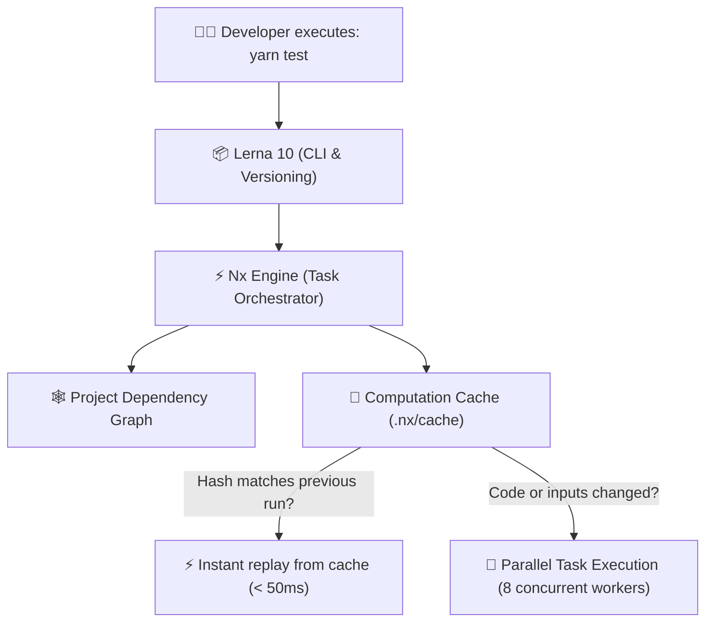

# ⚡ The Definitive Monorepo Guide: Lerna 10 + Nx Workspaces

<div align="center">

[](https://lerna.js.org/)
[](https://nx.dev/)
[](https://classic.yarnpkg.com/en/docs/workspaces/)
[](https://vuejs.org/)
[](https://vite.dev/)
[](https://storybook.js.org/)

**Engineering guide, architecture overview, and developer workflows for Components Kit.**  
*Everything you need to know from your initial `git clone` to authoring, testing, and releasing components.*

</div>

---

## 📑 Table of Contents

1. [What is this Monorepo and How Does Lerna 10 Work?](#1-what-is-this-monorepo-and-how-does-lerna-10-work)
   - [The Lerna 10 + Nx Engine Alliance](#the-lerna-10--nx-engine-alliance)
   - [How Yarn Workspaces Work](#how-yarn-workspaces-work)
   - [The Power of Computation Caching](#the-power-of-computation-caching)
2. [Interactive Dependency Graph](#2-interactive-dependency-graph)
3. [Running Commands: Entire Monorepo vs. Single Package](#3-running-commands-entire-monorepo-vs-single-package)
   - [Global Commands (All Packages)](#global-commands-all-packages)
   - [Scoping to a Single Package (3 Simple Methods)](#scoping-to-a-single-package-3-simple-methods)
   - [Advanced Filtering with Lerna](#advanced-filtering-with-lerna)
4. [Step-by-Step Tutorial: Authoring a New Component](#4-step-by-step-tutorial-authoring-a-new-component)
   - [Step 1: Create the Directory Structure](#step-1-create-the-directory-structure)
   - [Step 2: Configure the Component's package.json](#step-2-configure-the-components-packagejson)
   - [Step 3: Author the Vue 3 Component (`.vue`)](#step-3-author-the-vue-3-component-vue)
   - [Step 4: SCSS Styling & Design Tokens (`.scss`)](#step-4-scss-styling--design-tokens-scss)
   - [Step 5: Exporting Entry Point (`index.js`)](#step-5-exporting-entry-point-indexjs)
   - [Step 6: Write the Unit Test with Vitest (`.test.js`)](#step-6-write-the-unit-test-with-vitest-testjs)
   - [Step 7: Connect to Storybook 10](#step-7-connect-to-storybook-10)
   - [Step 8: Validate Build, Tests, and Linting](#step-8-validate-build-tests-and-linting)
5. [Managing and Updating Dependencies](#5-managing-and-updating-dependencies)
   - [Adding a Dependency to a Single Package](#adding-a-dependency-to-a-single-package)
   - [Adding a Tool to the Monorepo Root](#adding-a-tool-to-the-monorepo-root)
   - [Upgrading Existing Dependencies](#upgrading-existing-dependencies)
6. [Versioning and Package Publishing](#6-versioning-and-package-publishing)
   - [Independent Versioning (`independent`)](#independent-versioning-independent)
   - [Conventional Commits Enforcement](#conventional-commits-enforcement)
   - [Release Workflow: Bumping and Publishing](#release-workflow-bumping-and-publishing)
   - [Why Packages Are Marked `"private": true`](#why-packages-are-marked-private-true)
7. [Troubleshooting & FAQ](#7-troubleshooting--faq)
8. [Command Quick Reference (Cheat Sheet)](#8-command-quick-reference-cheat-sheet)

---

## 1. What is this Monorepo and How Does Lerna 10 Work?

A **monorepo** is a single Git repository containing multiple distinct yet collaborative projects or packages with clear boundaries.

In `components-kit`, we host:
* **14 Atomic UI Component Libraries** (`packages/components/ckl-*`)
* **1 Curated SVG Icon & Asset Package** (`packages/assets`)
* **1 Shared SCSS Styling Mixins Package** (`packages/styles`)
* **1 Unified Build & Test CLI** (`packages/components-kit`)
* **1 Shared ESLint Configuration** (`packages/eslint-config-components`)
* **1 Visual Storybook 10 Application** (`apps/storybook`)

### The Lerna 10 + Nx Engine Alliance

Historically, Lerna executed tasks sequentially and suffered from performance bottlenecks. Starting with Lerna 6 and now in **Lerna 10**, Lerna acts as the high-level workspace CLI while delegating all task execution, topological ordering, and computation caching to the **Nx engine**:



1. **Topological Task Scheduling:** If package `A` depends on package `B`, Nx guarantees that `B` builds before `A` automatically.
2. **Maximum Concurrency:** Tasks run across multiple parallel worker threads, fully utilizing all available CPU cores.
3. **Clean Terminal Reporting:** Real-time visual progress spinners show the exact execution status of each workspace task.

---

### How Yarn Workspaces Work

The root [package.json](file:///Users/nelo/proyectos/components-kit/package.json) defines our workspace package boundaries:

```json
"workspaces": {
  "packages": [
    "apps/storybook",
    "packages/assets",
    "packages/components/*",
    "packages/eslint-config-components",
    "packages/components-kit"
  ]
}
```

#### The Superpower: Local Symlinks
When a component package needs to use icons from `@components-kit/assets`, its `package.json` specifies:
```json
"dependencies": {
  "@components-kit/assets": "*"
}
```
Yarn **never downloads this from npm**: it creates a direct local filesystem symlink to `packages/assets`. When you edit an icon in `packages/assets`, all components and Storybook reflect the change instantly with sub-second Vite HMR!

---

### The Power of Computation Caching

In [nx.json](file:///Users/nelo/proyectos/components-kit/nx.json), caching is configured for `build` and `lint`:

```json
{
  "$schema": "node_modules/nx/schemas/nx-schema.json",
  "targetDefaults": {
    "build": {
      "cache": true,
      "dependsOn": ["^build"]
    },
    "lint": {
      "cache": true
    }
  }
}
```

#### How Does Nx Know What Changed?
Nx computes a **cryptographic hash** combining:
1. The exact source code of the package.
2. The code of any local workspace dependencies imported by that package.
3. The Node.js runtime version, OS architecture, and environment configuration.

* If the calculated hash matches a previous run: **it skips execution entirely**, restoring generated outputs and logs from `.nx/cache` in **< 50ms**.
* If you edit one line in `ckl-button`: Nx will only execute tasks for `ckl-button` and packages that directly depend on it. Everything else is retrieved from cache.

> [!TIP]
> If you ever need to bypass the cache and force a clean re-execution, append `--skip-nx-cache`:
> ```bash
> yarn build --skip-nx-cache
> ```

---

## 2. Interactive Dependency Graph

Want to visualize how packages in the monorepo depend on one another? Nx includes a built-in interactive graph viewer:

```bash
yarn graph
```

This launches a local web server in your browser where you can:
* Focus on a specific component to see everything that imports it or depends on it.
* Trace the critical path for builds.
* Identify circular dependencies before they cause runtime problems.

To export the graph as a static JSON file (useful for CI/CD audit pipelines):
```bash
yarn graph --file=dist/graph.json
```

---

## 3. Running Commands: Entire Monorepo vs. Single Package

### Global Commands (All Packages)

These commands run across **every package in the monorepo** in parallel using the Nx engine:

| Command | Action | Description |
| :--- | :--- | :--- |
| `yarn build` | **Build All** | Builds all 14 components and the Storybook app in topological order. |
| `yarn test` | **Test All** | Executes all 28 Vitest test suites in parallel across the monorepo. |
| `yarn lint` | **Lint All** | Runs ESLint and Stylelint across all 16 workspace projects. |
| `yarn storybook:dev` | **Dev Environment** | Starts the interactive Storybook catalog at `http://localhost:6006`. |

---

### Scoping to a Single Package (3 Simple Methods)

Suppose you are actively working on `ckl-badge`. You do not need to run tests or build all 13 other packages every few seconds. You have 3 convenient ways to target only `ckl-badge`:

#### Method 1: Via Lerna `--scope` (Recommended from Root)
From the monorepo root:
```bash
# Run tests only for ckl-badge
yarn lerna run test --scope=@components-kit/ckl-badge

# Build only ckl-badge
yarn lerna run build --scope=@components-kit/ckl-badge

# Lint only ckl-badge
yarn lerna run lint --scope=@components-kit/ckl-badge
```

#### Method 2: Via Yarn `--cwd` (Ideal for Watch Mode)
Yarn lets you invoke any package's internal scripts directly:
```bash
# Watch mode: re-runs tests instantly as you modify code
yarn --cwd packages/components/ckl-badge test:watch

# Build the package distribution directly
yarn --cwd packages/components/ckl-badge build
```

#### Method 3: Via Nx Direct Command
Nx resolves workspace project names directly:
```bash
yarn nx test @components-kit/ckl-badge
yarn nx build @components-kit/ckl-badge
```

---

### Advanced Filtering with Lerna

Lerna 10 provides flexible filtering options:

```bash
# Run tasks ONLY on packages modified since the main branch
yarn lerna run test --since=origin/main

# Run tasks on matching packages using a wildcard
yarn lerna run build --scope="@components-kit/ckl-*-tabs"

# Run tasks on all packages EXCEPT one
yarn lerna run test --ignore=storybook
```

---

## 4. Step-by-Step Tutorial: Authoring a New Component

Let's walk through creating a brand new component named **`ckl-avatar`** following repository standards.

### Step 1: Create the Directory Structure

Inside `packages/components/`, create the `ckl-avatar` folder and its `src/` subfolder:

```bash
mkdir -p packages/components/ckl-avatar/src
```

The resulting package layout should match:
```text
packages/components/ckl-avatar/
├── .eslintrc.json
├── README.md
├── package.json
└── src/
    ├── ckl-avatar.vue
    ├── ckl-avatar.scss
    ├── ckl-avatar.test.js
    └── index.js
```

---

### Step 2: Configure the Component's package.json

Create `packages/components/ckl-avatar/package.json`:

```json
{
  "name": "@components-kit/ckl-avatar",
  "version": "1.0.0",
  "type": "module",
  "main": "./src/index.js",
  "module": "./src/index.js",
  "exports": {
    ".": "./src/index.js",
    "./src": "./src/index.js"
  },
  "scripts": {
    "build": "kit-cli build",
    "test": "kit-cli test",
    "test:watch": "kit-cli test --watch",
    "lint": "eslint src"
  },
  "devDependencies": {
    "@components-kit/components-kit": "*",
    "eslint-config-components": "^1.0.0"
  },
  "private": true,
  "license": "MIT"
}
```

> [!NOTE]
> Notice how `"@components-kit/components-kit": "*"` provides the central `kit-cli` tool (Vite + Vitest) without needing to configure bundlers from scratch.

Add the standard ESLint configuration in `packages/components/ckl-avatar/.eslintrc.json`:
```json
{
  "root": true,
  "extends": ["components"]
}
```

---

### Step 3: Author the Vue 3 Component (`.vue`)

Create `packages/components/ckl-avatar/src/ckl-avatar.vue`:

```vue
<script setup>
import { computed } from "vue";

const props = defineProps({
  src: {
    type: String,
    default: "",
  },
  alt: {
    type: String,
    default: "Avatar image",
  },
  size: {
    type: String,
    default: "medium",
    validator: (val) => ["small", "medium", "large"].includes(val),
  },
  shape: {
    type: String,
    default: "circle",
    validator: (val) => ["circle", "square"].includes(val),
  },
});

const emit = defineEmits(["click"]);

const classes = computed(() => [
  "ckl-avatar",
  `ckl-avatar--${props.size}`,
  `ckl-avatar--${props.shape}`,
]);
</script>

<template>
  <div :class="classes" role="img" :aria-label="alt" @click="emit('click')">
    
    <span v-else class="ckl-avatar__fallback">
      <slot>👤</slot>
    </span>
  </div>
</template>

<style lang="scss">
@import "./ckl-avatar.scss";
</style>
```

---

### Step 4: SCSS Styling & Design Tokens (`.scss`)

Create `packages/components/ckl-avatar/src/ckl-avatar.scss`.  
Use the shared `default-styles` mixin from `packages/styles` so consumers can override CSS custom properties easily:

```scss
@import "@components-kit/styles/src/mixins.scss";

$avatar-defaults: (
  "size-small": 32px,
  "size-medium": 48px,
  "size-large": 64px,
  "border-radius": 50%,
  "background-color": var(--grey-400, #94a3b8),
  "color": var(--white, #ffffff),
);

@include default-styles("avatar", $avatar-defaults);

.ckl-avatar {
  display: inline-flex;
  align-items: center;
  justify-content: center;
  overflow: hidden;
  background-color: var(--ckl-avatar-background-color);
  color: var(--ckl-avatar-color);

  &--circle {
    border-radius: var(--ckl-avatar-border-radius);
  }

  &--square {
    border-radius: 8px;
  }

  &--small {
    width: var(--ckl-avatar-size-small);
    height: var(--ckl-avatar-size-small);
  }

  &--medium {
    width: var(--ckl-avatar-size-medium);
    height: var(--ckl-avatar-size-medium);
  }

  &--large {
    width: var(--ckl-avatar-size-large);
    height: var(--ckl-avatar-size-large);
  }

  &__image {
    width: 100%;
    height: 100%;
    object-fit: cover;
  }
}
```

---

### Step 5: Exporting Entry Point (`index.js`)

Create `packages/components/ckl-avatar/src/index.js`.  
This exports the component as both a named ESM export and a Vue plugin (`app.use`):

```javascript
import CklAvatar from "./ckl-avatar.vue";

export { CklAvatar };

export default {
  install(app) {
    app.component("CklAvatar", CklAvatar);
  },
};
```

---

### Step 6: Write the Unit Test with Vitest (`.test.js`)

Create `packages/components/ckl-avatar/src/ckl-avatar.test.js`:

```javascript
import { mount } from "@vue/test-utils";
import { describe, it, expect } from "vitest";
import CklAvatar from "./ckl-avatar.vue";

describe("CklAvatar Component", () => {
  it("renders correctly with default props", () => {
    const wrapper = mount(CklAvatar);
    expect(wrapper.classes()).toContain("ckl-avatar");
    expect(wrapper.classes()).toContain("ckl-avatar--medium");
    expect(wrapper.classes()).toContain("ckl-avatar--circle");
  });

  it("renders image when src prop is provided", () => {
    const src = "https://example.com/avatar.jpg";
    const wrapper = mount(CklAvatar, {
      props: { src, alt: "User avatar" },
    });
    const img = wrapper.find("img");
    expect(img.exists()).toBe(true);
    expect(img.attributes("src")).toBe(src);
  });

  it("emits click event on user click", async () => {
    const wrapper = mount(CklAvatar);
    await wrapper.trigger("click");
    expect(wrapper.emitted("click")).toHaveLength(1);
  });
});
```

---

### Step 7: Connect to Storybook 10

To make your component available in the interactive workbench:

1. **Add the workspace dependency in `apps/storybook/package.json`**:
   ```json
   "dependencies": {
     "@components-kit/ckl-avatar": "*",
     ...
   }
   ```
2. **Run `yarn install`** at the monorepo root so Yarn generates the local symlink.
3. **Add the story in `apps/storybook/stories/ckl-avatar/index.stories.js`**:

```javascript
import { CklAvatar } from "@components-kit/ckl-avatar";

export default {
  title: "components/ckl-avatar",
  component: CklAvatar,
  tags: ["autodocs"],
  argTypes: {
    size: {
      control: "select",
      options: ["small", "medium", "large"],
    },
    shape: {
      control: "select",
      options: ["circle", "square"],
    },
  },
};

export const Default = {
  args: {
    src: "https://images.unsplash.com/photo-1534528741775-53994a69daeb?w=150",
    alt: "Profile photo",
    size: "medium",
    shape: "circle",
  },
};
```

---

### Step 8: Validate Build, Tests, and Linting

Verify your component against all monorepo quality standards:

```bash
# 1. Run unit tests
yarn lerna run test --scope=@components-kit/ckl-avatar

# 2. Compile ESM bundle
yarn lerna run build --scope=@components-kit/ckl-avatar

# 3. Check code style with ESLint
yarn lerna run lint --scope=@components-kit/ckl-avatar

# 4. Preview in Storybook
yarn storybook:dev
```

---

## 5. Managing and Updating Dependencies

### Adding a Dependency to a Single Package

If an individual component requires an external npm library (for example, `canvas-confetti`):

```bash
# Syntax: yarn --cwd <package_directory> add <library>
yarn --cwd packages/components/ckl-badge add canvas-confetti
```

### Adding a Tool to the Monorepo Root

When installing developer tooling that applies across the entire repository (linters, formatters, global scripts), always specify the `-W` flag (`--ignore-workspace-root-check`):

```bash
# Syntax: yarn add -D -W <tool>
yarn add -D -W prettier-plugin-tailwindcss
```

### Upgrading Existing Dependencies

```bash
# Interactively review and upgrade dependencies across all workspaces
yarn upgrade-interactive

# Upgrade a package within a single workspace
yarn --cwd packages/assets upgrade
```

---

## 6. Versioning and Package Publishing

### Independent Versioning (`independent`)

In [lerna.json](file:///Users/nelo/proyectos/components-kit/lerna.json), we configure:
```json
{
  "version": "independent"
}
```

#### What Does This Mean?
* In traditional monorepos using **fixed versions**, modifying one package forces all 14 packages to increment their version numbers together.
* Under **independent versioning**, each package maintains its own semantic version:
  * `ckl-badge` can be at `1.4.2`
  * `ckl-carousel` can be at `2.1.0`
  * `ckl-icon` can be at `1.0.3`

Lerna uses `git diff` against tags to detect exactly which folders changed, proposing version bumps only for packages with actual modifications.

---

### Conventional Commits Enforcement

The repository enforces **Husky + Commitlint** on every commit. Messages must follow the standard convention:

```text
type(scope): brief description in lowercase
```

| Type | When to Use | SemVer Impact on Release |
| :--- | :--- | :---: |
| `fix(ckl-badge):` | Bug fix | **Patch** (`1.0.0` ➔ `1.0.1`) |
| `feat(ckl-carousel):` | New feature | **Minor** (`1.0.0` ➔ `1.1.0`) |
| `feat(ckl-icon)!:` | Breaking change | **Major** (`1.0.0` ➔ `2.0.0`) |
| `chore:`, `docs:`, `style:` | Maintenance or documentation | No release bump |

---

### Release Workflow: Bumping and Publishing

The command in [package.json](file:///Users/nelo/proyectos/components-kit/package.json) is:
```bash
yarn lerna:version
```
Which executes under the hood:
```bash
lerna version --no-private --no-push
```

#### What Happens Step-by-Step?
1. Lerna inspects commits created since the latest Git tag.
2. Identifies modified packages.
3. Prompts interactively for the version bump type (Patch, Minor, Major).
4. Updates each affected package's `package.json`.
5. Creates the corresponding local Git tags (e.g. `@components-kit/ckl-badge@1.1.0`).

When ready to publish to an npm registry (public or private):
```bash
lerna publish from-git
```
This reads the newly generated Git tags and publishes only the newly versioned packages.

---

### Why Packages Are Marked `"private": true`

All components in this monorepo currently define `"private": true`:
* **Accidental Publish Guard:** Prevents developers from inadvertently running `npm publish` and exposing internal libraries to the public npmjs.com registry.
* **Internal Distribution:** Suitable for consumption via private Git repositories, submodules, or enterprise artifact registries (such as Verdaccio, Nexus, or GitHub Packages).
* When you are ready to publish a package to a public or private npm registry, simply remove `"private": true` from that package's individual `package.json`.

---

## 7. Troubleshooting & FAQ

### Q: Storybook or Vite cannot resolve a newly created component.
**A:** Ensure you added `"@components-kit/ckl-your-component": "*"` to `apps/storybook/package.json` and executed `yarn install` at the monorepo root to create the local symlink in `node_modules`.

---

### Q: I edited code, but `yarn test` or `yarn build` finished in 50ms stating `read from cache`.
**A:** Nx detected that the source files have not changed since the last execution. To bypass the cache and force a complete rerun:
```bash
yarn test --skip-nx-cache
yarn build --skip-nx-cache
```

---

### Q: Dependencies or node_modules appear out of sync after checking out another branch.
**A:** Perform a deep monorepo cleanup:
```bash
# Removes all node_modules from all workspace packages
yarn lerna clean --yes

# Remove root node_modules and reinstall cleanly
rm -rf node_modules yarn.lock
yarn install
```

---

### Q: Git rejected my commit stating `commit-msg hook failed`.
**A:** Commitlint requires the Conventional Commit syntax. Example of an accepted message:
```bash
git commit -m "fix(ckl-badge): adjust border radius alignment in oval shape"
```

---

## 8. Command Quick Reference (Cheat Sheet)

```bash
# ========================================================
# 🚀 EVERYDAY WORKFLOW
# ========================================================
yarn storybook:dev                    # Launch Storybook 10 at http://localhost:6006
yarn test                            # Run ALL unit test suites in parallel
yarn build                           # Compile ALL packages across the monorepo
yarn lint                            # Run ESLint & Stylelint on all projects

# ========================================================
# 🎯 SINGLE PACKAGE SCOPING
# ========================================================
yarn lerna run test --scope=@components-kit/ckl-badge    # Test only ckl-badge
yarn lerna run build --scope=@components-kit/ckl-badge   # Build only ckl-badge
yarn --cwd packages/components/ckl-badge test:watch      # Live test watch mode

# ========================================================
# 🔍 VISUALIZATION & DIAGNOSTICS
# ========================================================
yarn graph                           # Open interactive 3D dependency graph
yarn audit                           # Check security vulnerabilities

# ========================================================
# 📦 VERSIONING & CLEANUP
# ========================================================
yarn lerna:version                   # Bump independent semantic versions
yarn lerna clean                     # Purge all workspace node_modules
```

---

<div align="center">
  <sub>Components Kit Monorepo Guide • Built with 💖 and Lerna 10 + Nx Workspaces.</sub>
</div>
