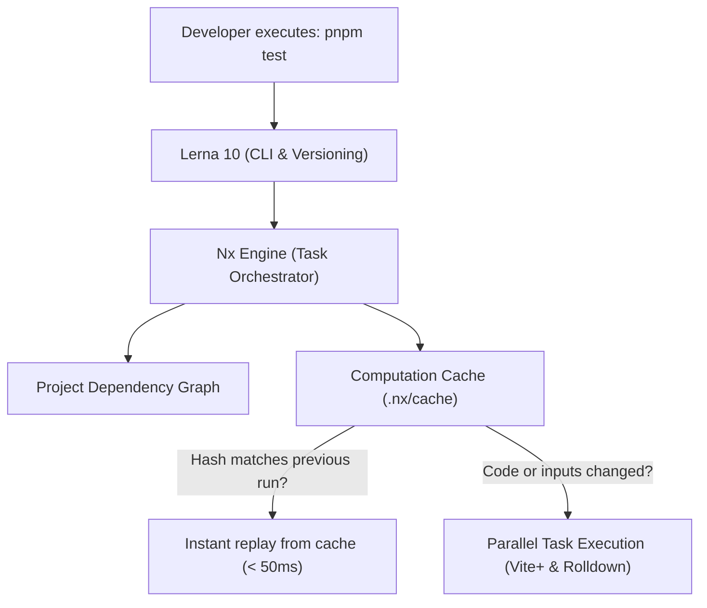

# The Definitive Monorepo Guide: Lerna 10 + Nx Workspaces

<div align="center">

[](https://lerna.js.org/)
[](https://nx.dev/)
[](https://pnpm.io/)
[](https://vuejs.org/)
[](https://viteplus.dev/)
[](https://storybook.js.org/)
[](https://nodejs.org/)

**Engineering guide, architecture overview, and developer workflows for Components Kit.**  
_Everything you need to know from your initial `git clone` to authoring, testing, and releasing components._

</div>

---

## Table of Contents

1. [What is this Monorepo and How Does Lerna 10 Work?](#1-what-is-this-monorepo-and-how-does-lerna-10-work)
   - [The Lerna 10 + Nx Engine Alliance](#the-lerna-10--nx-engine-alliance)
   - [How pnpm Workspaces Work](#how-pnpm-workspaces-work)
   - [The Power of Computation Caching](#the-power-of-computation-caching)
2. [Interactive Dependency Graph](#2-interactive-dependency-graph)
3. [Running Commands: Entire Monorepo vs. Single Package](#3-running-commands-entire-monorepo-vs-single-package)
   - [Global Commands (All Packages)](#global-commands-all-packages)
   - [Scoping to a Single Package (3 Simple Methods)](#scoping-to-a-single-package-3-simple-methods)
   - [Advanced Filtering with Lerna](#advanced-filtering-with-lerna)
4. [Step-by-Step Tutorial: Authoring a New Component](#4-step-by-step-tutorial-authoring-a-new-component)
   - [Step 1: Create the Directory Structure](#step-1-create-the-directory-structure)
   - [Step 2: Configure the Component's package.json](#step-2-configure-the-components-packagejson)
   - [Step 3: Author the Vue 3 Component (`.vue`)](#step-3-author-the-vue-3-component-vue)
   - [Step 4: SCSS Styling & Design Tokens (`.scss`)](#step-4-scss-styling--design-tokens-scss)
   - [Step 5: Exporting Entry Point (`index.js`)](#step-5-exporting-entry-point-indexjs)
   - [Step 6: Write the Unit Test with Vitest (`.test.js`)](#step-6-write-the-unit-test-with-vitest-testjs)
   - [Step 7: Connect to Storybook 10](#step-7-connect-to-storybook-10)
   - [Step 8: Validate Build, Tests, and Linting](#step-8-validate-build-tests-and-linting)
5. [Managing and Updating Dependencies](#5-managing-and-updating-dependencies)
   - [Adding a Dependency to a Single Package](#adding-a-dependency-to-a-single-package)
   - [Adding a Tool to the Monorepo Root](#adding-a-tool-to-the-monorepo-root)
   - [Upgrading Existing Dependencies](#upgrading-existing-dependencies)
6. [Versioning and Package Publishing](#6-versioning-and-package-publishing)
   - [Independent Versioning (`independent`)](#independent-versioning-independent)
   - [Conventional Commits Enforcement](#conventional-commits-enforcement)
   - [Release Workflow: Bumping and Publishing](#release-workflow-bumping-and-publishing)
   - [Why Packages Are Marked `"private": true`](#why-packages-are-marked-private-true)
7. [Troubleshooting & FAQ](#7-troubleshooting--faq)
8. [Command Quick Reference (Cheat Sheet)](#8-command-quick-reference-cheat-sheet)

---

## 1. What is this Monorepo and How Does Lerna 10 Work?

A **monorepo** is a single Git repository containing multiple distinct yet collaborative projects or packages with clear boundaries.

In `components-kit`, we host:

- **14 Atomic UI Component Libraries for Vue 3** (`packages/vue/ckl-*`)
- **14 Atomic UI Component Libraries for React 19** (`packages/react/ckl-*`)
- **1 Curated SVG Icon & Asset Package** (`packages/assets`) with dual Vue & React `IalIcon` exports
- **1 Shared SCSS Styling Mixins Package** (`packages/styles`)
- **1 Pure Mathematical & Event Helpers Package** (`packages/core`)
- **1 Unified Build & Test Engine powered by Vite+ & Rolldown** (`packages/tooling`)
- **3-Tier Storybook 10 Composition Portal** (`apps/storybook-portal`, `apps/storybook-vue`, `apps/storybook-react`)
- **Vite+ Unified Toolchain** (`vite.config.ts` powered by Oxlint, Oxfmt, Vitest 5, and Vite Task)

### The Lerna 10 + Nx Engine Alliance

Historically, Lerna executed tasks sequentially and suffered from performance bottlenecks. Starting with Lerna 6 and now in **Lerna 10**, Lerna acts as the high-level workspace CLI while delegating all task execution, topological ordering, and computation caching to the **Nx engine**:



1. **Topological Task Scheduling:** If package `A` depends on package `B`, Nx guarantees that `B` builds before `A` automatically.
2. **Maximum Concurrency:** Tasks run across multiple parallel worker threads, fully utilizing all available CPU cores.
3. **Clean Terminal Reporting:** Real-time visual progress spinners show the exact execution status of each workspace task.

### System Requirements: Node.js >= 24 & pnpm 11

> [!IMPORTANT]
> **Node.js 24 Minimum Requirement**: This repository strictly requires **Node.js `>= 24.0.0`** and **pnpm `>= 11.0.0`**.
> Legacy runtimes (**Node 20 and Node 22**) are **not supported** due to toolchain dependencies (Vite+ 1.3 / Rolldown / Storybook 10 native features).
> Version enforcement is configured via `.nvmrc`, `.node-version`, and `"engine-strict=true"` in `.npmrc`.

---

### How pnpm Workspaces Work

The workspace structure is defined in [pnpm-workspace.yaml](file:///Users/nelo/proyectos/components-kit/pnpm-workspace.yaml):

```yaml
packages:
  - "apps/*"
  - "packages/assets"
  - "packages/styles"
  - "packages/core"
  - "packages/vue/*"
  - "packages/react/*"
  - "packages/tooling"

linkWorkspacePackages: true
preferWorkspacePackages: true
```

#### The Superpower: Local Symlinks & Strict Isolation

When a component package needs to use icons from `@components-kit/assets`, its `package.json` specifies:

```json
"dependencies": {
  "@components-kit/assets": "*"
}
```

pnpm **never downloads this from npm**: it creates a direct local filesystem symlink to `packages/assets`. When you edit an icon in `packages/assets`, all components and Storybook reflect the change instantly with sub-second Vite+ HMR! Unlike legacy package managers, pnpm prevents "phantom dependencies" through content-addressable storage and isolated symlink trees.

---

### The Power of Computation Caching

In [nx.json](file:///Users/nelo/proyectos/components-kit/nx.json), caching is configured for `build` and `lint`:

```json
{
  "$schema": "node_modules/nx/schemas/nx-schema.json",
  "targetDefaults": {
    "build": {
      "cache": true,
      "dependsOn": ["^build"]
    },
    "lint": {
      "cache": true
    }
  }
}
```

#### How Does Nx Know What Changed?

Nx computes a **cryptographic hash** combining:

1. The exact source code of the package.
2. The code of any local workspace dependencies imported by that package.
3. The Node.js runtime version, OS architecture, and environment configuration.

- If the calculated hash matches a previous run: **it skips execution entirely**, restoring generated outputs and logs from `.nx/cache` in **< 50ms**.
- If you edit one line in `ckl-button`: Nx will only execute tasks for `ckl-button` and packages that directly depend on it. Everything else is retrieved from cache.

> [!TIP]
> If you ever need to bypass the cache and force a clean re-execution, append `--skip-nx-cache`:
>
> ```bash
> pnpm build --skip-nx-cache
> ```

---

## 2. Interactive Dependency Graph

Want to visualize how packages in the monorepo depend on one another? Nx includes a built-in interactive graph viewer:

```bash
pnpm graph
```

This launches a local web server in your browser where you can:

- Focus on a specific component to see everything that imports it or depends on it.
- Trace the critical path for builds.
- Identify circular dependencies before they cause runtime problems.

To export the graph as a static JSON file (useful for CI/CD audit pipelines):

```bash
pnpm graph --file=dist/graph.json
```

---

## 3. Running Commands: Entire Monorepo vs. Single Package

### Global Commands (All Packages)

These commands run across **every package in the monorepo** in parallel using the Nx engine:

| Command              | Action              | Description                                                                                           |
| :------------------- | :------------------ | :---------------------------------------------------------------------------------------------------- |
| `pnpm build`         | **Build All**       | Builds all 14 components and the Storybook app in topological order via Rolldown (`vp run -r build`). |
| `pnpm test`          | **Test All**        | Executes all 28 Vitest 5 test suites in parallel across the monorepo (`vp run -r test`).              |
| `pnpm lint`          | **Lint All**        | Runs Oxlint across all files in the monorepo in < 700ms (`vp lint`).                                  |
| `pnpm fmt`           | **Format All**      | Formats code in place using Oxfmt (`vp fmt`).                                                         |
| `pnpm check`         | **Unified Check**   | Runs formatting, linting, and type checking in a single pass (`vp check`).                            |
| `pnpm storybook:dev` | **Dev Environment** | Starts the interactive Storybook catalog at `http://localhost:6006`.                                  |

---

### Scoping to a Single Package (3 Simple Methods)

Suppose you are actively working on `ckl-badge`. You do not need to run tests or build all 13 other packages every few seconds. You have 3 convenient ways to target only `ckl-badge`:

#### Method 1: Via Lerna `--scope` (Recommended from Root)

From the monorepo root:

```bash
# Run tests only for ckl-badge
pnpm lerna run test --scope=@components-kit/vue-ckl-badge

# Build only ckl-badge
pnpm lerna run build --scope=@components-kit/vue-ckl-badge

# Lint only ckl-badge
pnpm lerna run lint --scope=@components-kit/vue-ckl-badge
```

#### Method 2: Via pnpm `--filter` (Ideal for Watch Mode)

pnpm lets you filter and invoke any package's internal scripts directly:

```bash
# Watch mode: re-runs tests instantly as you modify code
pnpm --filter @components-kit/vue-ckl-badge test:watch

# Build the package distribution directly
pnpm --filter @components-kit/vue-ckl-badge build
```

#### Method 3: Via Nx Direct Command

Nx resolves workspace project names directly:

```bash
pnpm nx test @components-kit/vue-ckl-badge
pnpm nx build @components-kit/vue-ckl-badge
```

---

### Advanced Filtering with Lerna

Lerna 10 provides flexible filtering options:

```bash
# Run tasks ONLY on packages modified since the main branch
pnpm lerna run test --since=origin/main

# Run tasks on matching packages using a wildcard
pnpm lerna run build --scope="@components-kit/vue-ckl-*-tabs"

# Run tasks on all packages EXCEPT one
pnpm lerna run test --ignore=storybook
```

---

## 4. Step-by-Step Tutorial: Authoring a New Component

Let's walk through creating a brand new component named **`ckl-avatar`** following repository standards.

### Step 1: Create the Directory Structure

Inside `packages/vue/` (or `packages/react/` for React), create the `ckl-avatar` folder and its `src/` subfolder:

```bash
mkdir -p packages/vue/ckl-avatar/src
```

The resulting package layout should match:

```text
packages/vue/ckl-avatar/
├── README.md
├── package.json
└── src/
    ├── ckl-avatar.vue
    ├── ckl-avatar.scss
    ├── ckl-avatar.test.js
    └── index.js
```

---

### Step 2: Configure the Component's package.json

Create `packages/vue/ckl-avatar/package.json`:

```json
{
  "name": "@components-kit/vue-ckl-avatar",
  "version": "1.0.0",
  "type": "module",
  "main": "./src/index.js",
  "module": "./src/index.js",
  "exports": {
    ".": "./src/index.js",
    "./src": "./src/index.js"
  },
  "scripts": {
    "build": "kit-cli build",
    "test": "kit-cli test",
    "test:watch": "kit-cli test --watch",
    "lint": "vp lint src"
  },
  "devDependencies": {
    "@components-kit/tooling": "*"
  },
  "private": true,
  "license": "MIT"
}
```

> [!NOTE]
> Notice how `"@components-kit/tooling": "*"` provides the central `kit-cli` tool (Vite + Vitest) without needing to configure bundlers from scratch, while linting is handled natively by Vite+ via `vp lint src` without requiring any local `.eslintrc.json` file.

---

### Step 3: Author the Vue 3 Component (`.vue`)

Create `packages/vue/ckl-avatar/src/ckl-avatar.vue`:

````vue
<script setup>
import { computed } from "vue";

const props = defineProps({
  src: {
    type: String,
    default: "",
  },
  alt: {
    type: String,
    default: "Avatar image",
  },
  size: {
    type: String,
    default: "medium",
    validator: (val) => ["small", "medium", "large"].includes(val),
  },
  shape: {
    type: String,
    default: "circle",
    validator: (val) => ["circle", "square"].includes(val),
  },
});

const emit = defineEmits(["click"]);

const classes = computed(() => [
  "ckl-avatar",
  `ckl-avatar--${props.size}`,
  `ckl-avatar--${props.shape}`,
]);
</script>

<template>
  <div :class="classes" role="img" :aria-label="alt" @click="emit('click')">
    
    <span v-else class="ckl-avatar__fallback">
      <slot><ial-icon icon="ial-user" size="small" /></slot>
    </span>
  </div>
</template>

```vue
<!-- Pure UI component: no <style> block, no business logic -->
<template>
  <div :class="avatarClasses">
    
    <span v-else class="ckl-avatar__fallback">{{ initials }}</span>
  </div>
</template>
````

---

### Step 4: SCSS Styling in `@components-kit/styles`

Component stylesheets are centralized in `packages/styles` so that components ship zero CSS and consumers can import styles globally:

1. Create `packages/styles/src/components/_ckl-avatar.scss`.
2. Use the shared `default-styles` mixin:

```scss
$avatar-defaults: (
  "size-small": 32px,
  "size-medium": 48px,
  "size-large": 64px,
  "border-radius": 50%,
  "background-color": var(--grey-400, #94a3b8),
  "color": var(--white, #ffffff),
);

@include default-styles("avatar", $avatar-defaults);

.ckl-avatar {
  display: inline-flex;
  align-items: center;
  justify-content: center;
  overflow: hidden;
  background-color: var(--ckl-avatar-background-color);
  color: var(--ckl-avatar-color);

  &--circle {
    border-radius: var(--ckl-avatar-border-radius);
  }

  &--square {
    border-radius: 8px;
  }

  &--small {
    width: var(--ckl-avatar-size-small);
    height: var(--ckl-avatar-size-small);
  }

  &--medium {
    width: var(--ckl-avatar-size-medium);
    height: var(--ckl-avatar-size-medium);
  }

  &--large {
    width: var(--ckl-avatar-size-large);
    height: var(--ckl-avatar-size-large);
  }

  &__image {
    width: 100%;
    height: 100%;
    object-fit: cover;
  }
}
```

---

### Step 5: Exporting Entry Point (`index.js`)

Create `packages/vue/ckl-avatar/src/index.js`.  
This exports the component as both a named ESM export and a Vue plugin (`app.use`):

```javascript
import CklAvatar from "./ckl-avatar.vue";

export { CklAvatar };

export default {
  install(app) {
    app.component("CklAvatar", CklAvatar);
  },
};
```

---

### Step 6: Write the Unit Test with Vitest (`.test.js`)

Create `packages/vue/ckl-avatar/src/ckl-avatar.test.js`:

```javascript
import { mount } from "@vue/test-utils";
import { describe, it, expect } from "vitest";
import CklAvatar from "./ckl-avatar.vue";

describe("CklAvatar Component", () => {
  it("renders correctly with default props", () => {
    const wrapper = mount(CklAvatar);
    expect(wrapper.classes()).toContain("ckl-avatar");
    expect(wrapper.classes()).toContain("ckl-avatar--medium");
    expect(wrapper.classes()).toContain("ckl-avatar--circle");
  });

  it("renders image when src prop is provided", () => {
    const src = "https://example.com/avatar.jpg";
    const wrapper = mount(CklAvatar, {
      props: { src, alt: "User avatar" },
    });
    const img = wrapper.find("img");
    expect(img.exists()).toBe(true);
    expect(img.attributes("src")).toBe(src);
  });

  it("emits click event on user click", async () => {
    const wrapper = mount(CklAvatar);
    await wrapper.trigger("click");
    expect(wrapper.emitted("click")).toHaveLength(1);
  });
});
```

---

### Step 7: Connect to Storybook 10

To make your component available in the interactive workbench:

1. **Add the workspace dependency in `apps/storybook-portal/package.json`**:
   ```json
   "dependencies": {
     "@components-kit/vue-ckl-avatar": "*",
     ...
   }
   ```
2. **Run `pnpm install`** at the monorepo root so pnpm generates the local workspace symlink.
3. **Add the story in `apps/storybook-portal/stories/ckl-avatar/index.stories.js`**:

```javascript
import { CklAvatar } from "@components-kit/vue-ckl-avatar";

export default {
  title: "components/ckl-avatar",
  component: CklAvatar,
  tags: ["autodocs"],
  argTypes: {
    size: {
      control: "select",
      options: ["small", "medium", "large"],
    },
    shape: {
      control: "select",
      options: ["circle", "square"],
    },
  },
};

export const Default = {
  args: {
    src: "https://images.unsplash.com/photo-1534528741775-53994a69daeb?w=150",
    alt: "Profile photo",
    size: "medium",
    shape: "circle",
  },
};
```

---

### Step 8: Validate Build, Tests, and Linting

Verify your component against all monorepo quality standards:

```bash
# 1. Run unit tests
pnpm lerna run test --scope=@components-kit/vue-ckl-avatar

# 2. Compile ESM bundle
pnpm lerna run build --scope=@components-kit/vue-ckl-avatar

# 3. Check code style with Oxlint (Vite+)
pnpm --filter @components-kit/vue-ckl-avatar lint

# 4. Preview in Storybook
pnpm storybook:dev
```

---

## 5. Managing and Updating Dependencies

### Adding a Dependency to a Single Package

If an individual component requires an external npm library (for example, `canvas-confetti`):

```bash
# Syntax: pnpm --filter <package_name> add <library>
pnpm --filter @components-kit/vue-ckl-badge add canvas-confetti
```

### Adding a Tool to the Monorepo Root

When installing developer tooling that applies across the entire repository (linters, formatters, global scripts), always specify the `-w` flag (`--workspace-root`):

```bash
# Syntax: pnpm add -D -w <tool>
pnpm add -D -w prettier-plugin-tailwindcss
```

### Upgrading Existing Dependencies

```bash
# Interactively review and upgrade dependencies across all workspaces
pnpm update -i --recursive

# Upgrade a package within a single workspace
pnpm --filter @components-kit/assets update
```

---

## 6. Versioning and Package Publishing

### Independent Versioning (`independent`)

In [lerna.json](file:///Users/nelo/proyectos/components-kit/lerna.json), we configure:

```json
{
  "version": "independent"
}
```

#### What Does This Mean?

- In traditional monorepos using **fixed versions**, modifying one package forces all 14 packages to increment their version numbers together.
- Under **independent versioning**, each package maintains its own semantic version:
  - `ckl-badge` can be at `1.4.2`
  - `ckl-carousel` can be at `2.1.0`
  - `ckl-icon` can be at `1.0.3`

Lerna uses `git diff` against tags to detect exactly which folders changed, proposing version bumps only for packages with actual modifications.

---

### Quality & Commit Hooks (.vite-hooks/)

Git hooks are managed natively via **Vite+ Hooks (`vp hooks`)**, eliminating the need for third-party managers like Husky:

- **`pre-commit`** (`.vite-hooks/pre-commit`):
  1. Runs `vp staged`: automatically runs Oxlint and Oxfmt on staged files, fixing formatting issues before commit.
  2. Runs `vp run -r test`: verifies all unit tests across the 14 component packages pass (~1.8s) before allowing the commit.
- **`commit-msg`** (`.vite-hooks/commit-msg`):
  Executes **Commitlint** (`@commitlint/config-conventional`) to strictly enforce the Conventional Commits specification.

---

### Conventional Commits Specification & Rules

Every commit message in this monorepo must adhere to the standard Conventional Commits structure:

```text
<type>(<scope>): <subject>

[optional body: detailed explanation of the change]

[optional footer: breaking changes or issue references]
```

#### 1. Header Format Rules (Strictly Enforced)

- **`type`**: Must be in lowercase. See the table below for allowed types.
- **`scope`** (recommended): Name of the affected package or domain in lowercase (e.g. `ckl-badge`, `storybook`, `toolchain`, `deps`).
- **`subject`**:
  - Written in **lowercase** (e.g., `add click trigger support`, not `Add Click Trigger Support`).
  - Use the **imperative mood** (e.g., `fix`, `add`, `update`, not `fixed`, `added`, `updates`).
  - **No trailing period** (`.`) at the end of the subject.
  - Maximum header length: **100 characters**.

#### 2. Allowed Commit Types

| Type       | Description                                                             |   SemVer Impact on Release    |
| :--------- | :---------------------------------------------------------------------- | :---------------------------: |
| `feat`     | A new user-facing feature or component capability                       | **Minor** (`1.0.0` → `1.1.0`) |
| `fix`      | A bug fix for a component or tool                                       | **Patch** (`1.0.0` → `1.0.1`) |
| `docs`     | Documentation changes only (`README.md`, guides, inline comments)       |             None              |
| `style`    | Formatting changes that do not affect code meaning (whitespace, Oxfmt)  |             None              |
| `refactor` | Code restructuring without fixing a bug or adding a feature             |             None              |
| `perf`     | A code change that improves rendering or build performance              | **Patch** (`1.0.0` → `1.0.1`) |
| `test`     | Adding missing tests or correcting existing tests                       |             None              |
| `build`    | Changes to build system, bundling (Rolldown/Vite+), or external tooling |             None              |
| `ci`       | Changes to CI/CD configuration files and scripts                        |             None              |
| `chore`    | Maintenance tasks, dependency updates, or internal scripts              |             None              |
| `revert`   | Reverting a previous commit                                             |            Depends            |

#### 3. Recommended Scopes

- **Component Scopes**: `(ckl-badge)`, `(ckl-tooltip)`, `(ckl-carousel)`, `(ckl-side-nav)`, etc.
- **Workspace Scopes**: `(storybook)`, `(components-kit)`, `(assets)`.
- **Infrastructure Scopes**: `(toolchain)`, `(monorepo)`, `(deps)`, `(docs)`.

#### 4. Body and Footer Rules (Line Length Gotcha)

- **Separation**: There must be an empty blank line between the header, the body, and the footer.
- **Line Length Limit**: **Every line in the commit body must be <= 100 characters**. If lines exceed 100 characters, Commitlint will reject the commit with `[body-max-line-length]`. Always wrap long descriptions.
- **Breaking Changes**: Indicate a breaking change by appending `!` after the type/scope (e.g. `feat(ckl-icon)!: replace legacy font icons with inline SVGs`) or by including `BREAKING CHANGE: <explanation>` in the footer. This triggers a **Major** release (`1.0.0` → `2.0.0`).

#### 5. Concrete Examples

##### Valid Commit Messages

```bash
# Feature on a component
git commit -m "feat(ckl-tooltip): add interactive click trigger support"

# Bug fix
git commit -m "fix(ckl-side-nav): prevent reflow flickering during collapse"

# Documentation
git commit -m "docs(monorepo): document commit conventions and vite+ hooks"

# Breaking change with exclamation mark
git commit -m "feat(ckl-icon)!: drop support for legacy font icons"

# Multi-line commit with body (all body lines <= 100 chars)
git commit -m "feat(toolchain): migrate monorepo to Vite+ and Vitest 5

Migrate the entire repository toolchain to the 100% native Vite+ standard.
Replaces legacy Yarn, ESLint, Stylelint, Husky, and lint-staged."
```

##### Invalid Commit Messages (Blocked by Commitlint)

```bash
# ERROR: Capitalized subject
git commit -m "feat(ckl-badge): Add new outline variant"

# ERROR: Period at the end of the subject
git commit -m "fix(ckl-carousel): fix touch swipe gesture."

# ERROR: Past tense verb
git commit -m "fix(ckl-loader): fixed svg animation timing"

# ERROR: Unknown type
git commit -m "updated(deps): bump vite to 7.0.0"

# ERROR: Body line longer than 100 characters
# (Will fail with: body's lines must not be longer than 100 characters [body-max-line-length])
```

#### 6. Ignored Prefixes

Commits starting with `wip` or `publish` are exempt from Commitlint validation (configured in `commitlint.config.js`).

---

### Release Workflow: Bumping and Publishing

The command in [package.json](file:///Users/nelo/proyectos/components-kit/package.json) is:

```bash
pnpm lerna:version
```

Which executes under the hood:

```bash
lerna version --no-private --no-push
```

#### What Happens Step-by-Step?

1. Lerna inspects commits created since the latest Git tag.
2. Identifies modified packages.
3. Prompts interactively for the version bump type (Patch, Minor, Major).
4. Updates each affected package's `package.json`.
5. Creates the corresponding local Git tags (e.g. `@components-kit/vue-ckl-badge@1.1.0`).

When ready to publish to an npm registry (public or private):

```bash
lerna publish from-git
```

This reads the newly generated Git tags and publishes only the newly versioned packages.

---

### Why Packages Are Marked `"private": true`

All components in this monorepo currently define `"private": true`:

- **Accidental Publish Guard:** Prevents developers from inadvertently running `npm publish` and exposing internal libraries to the public npmjs.com registry.
- **Internal Distribution:** Suitable for consumption via private Git repositories, submodules, or enterprise artifact registries (such as Verdaccio, Nexus, or GitHub Packages).
- When you are ready to publish a package to a public or private npm registry, simply remove `"private": true` from that package's individual `package.json`.

---

## 7. Troubleshooting & FAQ

### Q: Storybook or Vite cannot resolve a newly created component.

**A:** Ensure you added `"@components-kit/vue-ckl-your-component": "*"` to `apps/storybook-portal/package.json` and executed `pnpm install` at the monorepo root to create the local symlink in `node_modules`.

---

### Q: I edited code, but `pnpm test` or `pnpm build` finished in 50ms stating `read from cache`.

**A:** Nx detected that the source files have not changed since the last execution. To bypass the cache and force a complete rerun:

```bash
pnpm test --skip-nx-cache
pnpm build --skip-nx-cache
```

---

### Q: Dependencies or node_modules appear out of sync after checking out another branch.

**A:** Perform a deep monorepo cleanup:

```bash
# Removes all node_modules from all workspace packages
pnpm lerna clean --yes

# Remove root node_modules and reinstall cleanly
rm -rf node_modules pnpm-lock.yaml
pnpm install
```

---

### Q: Git rejected my commit stating `commit-msg hook failed`.

**A:** Commitlint requires the Conventional Commit syntax. Example of an accepted message:

```bash
git commit -m "fix(ckl-badge): adjust border radius alignment in oval shape"
```

---

## 8. Command Quick Reference (Cheat Sheet)

```bash
# ========================================================
# EVERYDAY WORKFLOW
# ========================================================
pnpm storybook:dev                    # Launch ALL Storybooks in parallel (Portal 6005, Vue 6006, React 6007)
pnpm storybook:portal:dev             # Launch Storybook Composition Portal only (http://localhost:6005)
pnpm storybook:vue:dev                # Launch Vue 3 Storybook only (http://localhost:6006)
pnpm storybook:react:dev              # Launch React 19 Storybook only (http://localhost:6007)
pnpm storybook:build                  # Compile unified Composition Hub for GitHub Pages
pnpm test                             # Run ALL unit test suites in parallel (Vitest 5)
pnpm build                            # Compile ALL packages across monorepo (Rolldown / Vite Task)
pnpm lint                             # Fast Oxlint scan across all packages (< 700ms)
pnpm fmt                              # Format code in place using Oxfmt
pnpm check                            # Run format, lint, and type checks in a single pass

# ========================================================
# SINGLE PACKAGE SCOPING
# ========================================================
pnpm lerna run test --scope=@components-kit/vue-ckl-badge         # Test Vue ckl-badge
pnpm lerna run test --scope=@components-kit/react-ckl-badge   # Test React ckl-badge
pnpm lerna run build --scope=@components-kit/vue-ckl-badge        # Build Vue ckl-badge
pnpm lerna run build --scope=@components-kit/react-ckl-badge  # Build React ckl-badge
pnpm --filter @components-kit/vue-ckl-badge test:watch           # Live test watch mode

# ========================================================
# VISUALIZATION & DIAGNOSTICS
# ========================================================
pnpm graph                            # Open interactive 3D dependency graph
pnpm audit                            # Check security vulnerabilities

# ========================================================
# VERSIONING & CLEANUP
# ========================================================
pnpm lerna:version                    # Bump independent semantic versions
pnpm lerna clean                      # Purge all workspace node_modules
```

---

<div align="center">
  <sub>Components Kit Monorepo Guide • Built with Lerna 10 + Nx Workspaces.</sub>
</div>
